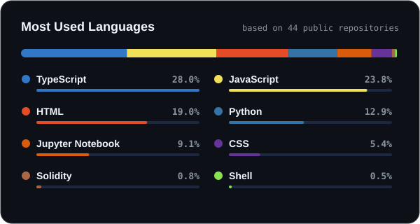

  
  
  

## About

I'm a third-year Electrical and Electronics Engineering student at Ramaiah Institute of Technology (CGPA 8.45). I work across hardware and software, from ESP32 firmware and 12 V automotive power design to production web applications. I'm currently a Full Stack Engineer Intern at DukaanSe.

## Experience

**Full Stack Engineer Intern**, DukaanSe · Remote · *Sep 2026 – Present*
- I develop and maintain product features across the frontend and backend using Next.js and the MERN stack.
- I work in a remote team on a live product, from UI components to API and database integration.

**Assistance Partner Apprentice**, Kotak Mahindra Bank · Bengaluru · *Dec 2025 – May 2026*
- I completed a six-month on-site apprenticeship supporting customer-facing banking operations.

## Skills

| Area | Technologies |
|---|---|
| Embedded and Hardware | ESP32, RP2040, Embedded C/C++, UART, I2C, GPIO, PWM, Bluetooth, sensor interfacing, PCB schematic design, 12 V power design |
| Software | Python, TypeScript, JavaScript, React, Next.js, Node.js, Express, MongoDB, FastAPI, SQLite, AWS DynamoDB, Docker, Git |
| AI and Security | LLM integration, AI agents, scikit-learn, DFIR, incident response, MITRE ATT&CK |

  

## Education

| Qualification | Institution | Year | Result |
|---|---|---|---|
| B.E., Electrical and Electronics Engineering | Ramaiah Institute of Technology, Bengaluru | 2024 – 2028 | CGPA 8.45 / 10 |
| Pre-University (PCMC) | Sri Siddaganga PU College, Davanagere | 2024 | 93.50% |
| SSLC | National English Medium High School, Koppal | 2022 | 97.44% |

## Certifications

- Fundamentals of Digital Design for VLSI Chip Design, L&T EduTech
- Python Essentials 1, Cisco Networking Academy / OpenEDG

## GitHub Stats

  
  

