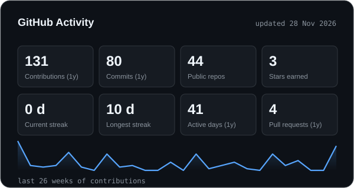

  
  
  
  
  

## ⚡ Featured Builds

  
  
  
  

## 🛠️ Tech Arsenal

<table>
  <tr>
    <td width="22%"><b>💻 Software</b></td>
    <td></td>
  </tr>
  <tr>
    <td><b>🔌 Embedded &amp; Hardware</b></td>
    <td>
      &nbsp;
      
      
      
      
      
      
    </td>
  </tr>
  <tr>
    <td><b>🧠 AI &amp; Security</b></td>
    <td>
      &nbsp;
      
      
      
      
    </td>
  </tr>
</table>

## 🏆 Achievements

| | Achievement | Project |
|:-:|---|---|
| 🥉 | **3rd Place**: SANS *"Find Evil"* Competition | ProofSIFT |
| 🥈 | **2nd Overall**: HackMars 3.0, NEON Track | FinWise |
| 🎯 | **Rank 22**: AI/ML-Powered FPGA Design & Simulation Hackathon, NIT Jamshedpur × VLSI for All | |
| 🚀 | **Finalist entry**: Seva First National Student Ideation Challenge 2026 | VeloSense |
| ⚔️ | **52 hackathons**, 12 published projects on [Devpost](https://devpost.com/karthikma321) | |

<b>🎓 Education · 💼 Experience · 📜 Certifications</b> (click to expand)

 

**💼 Experience**

| Role | Organisation | When |
|---|---|---|
| Full Stack Engineer Intern: Next.js & MERN, from UI components to APIs and databases | **DukaanSe** · Remote | Sep 2026 – Present |
| Assistance Partner Apprentice: customer-facing banking operations | **Kotak Mahindra Bank** · Bengaluru | Dec 2025 – May 2026 |

**🎓 Education**

| Qualification | Institution | Year | Score |
|---|---|---|---|
| B.E. Electrical & Electronics Engineering | Ramaiah Institute of Technology, Bengaluru | 2024 – 2028 | CGPA 8.45 |
| PCMC | Sri Siddaganga PU College, Davanagere | 2024 | 93.50% |
| SSLC | National English Medium High School, Koppal | 2022 | 97.44% |

**📜 Certifications**
- Fundamentals of Digital Design for VLSI Chip Design: L&T EduTech
- Python Essentials 1: Cisco Networking Academy / OpenEDG

## 📡 Live Telemetry

  
  

  

<picture>
  <source media="(prefers-color-scheme: dark)" srcset="https://raw.githubusercontent.com/sleader3221-dot/sleader3221-dot/output/snake-dark.svg"/>
  
</picture>

Telemetry refreshes automatically every day via GitHub Actions

